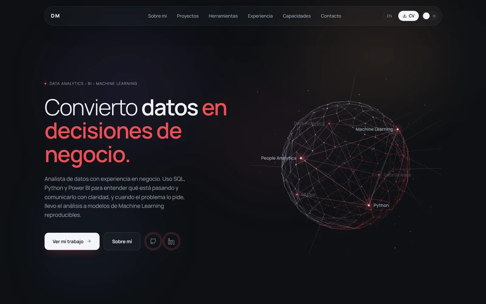
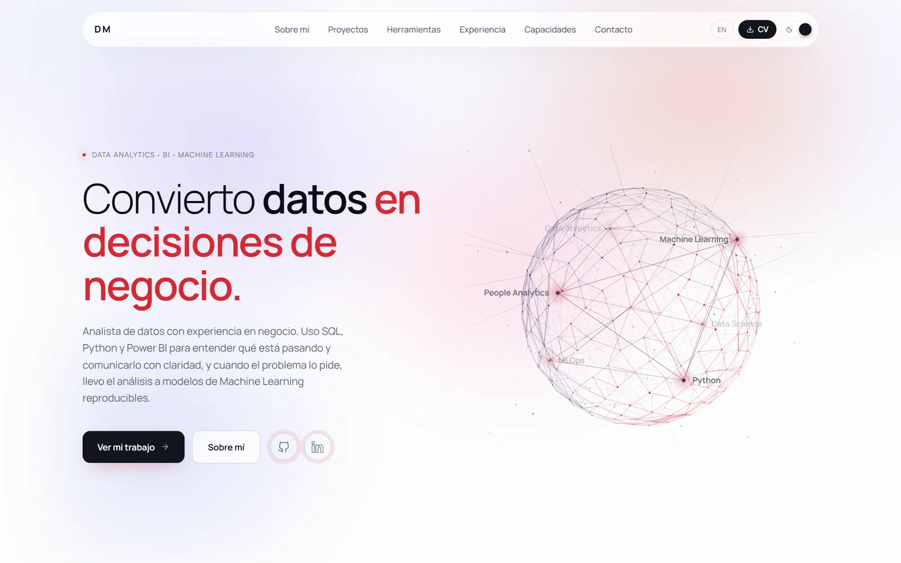
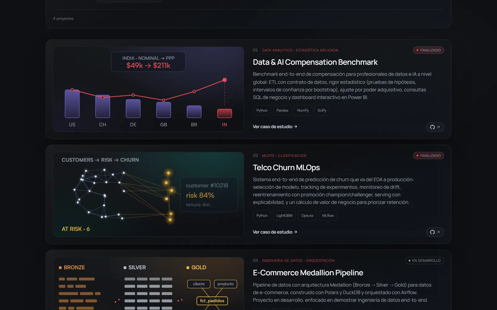
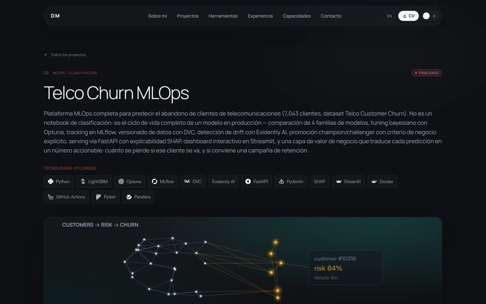
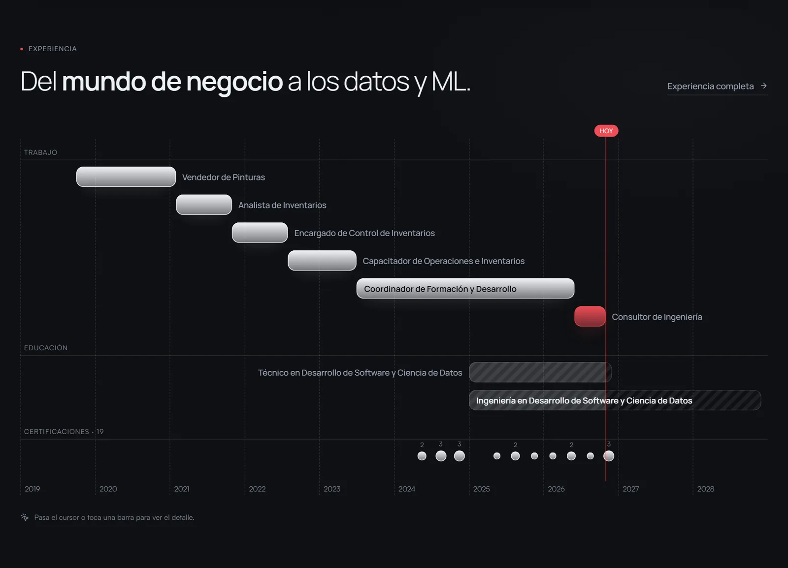
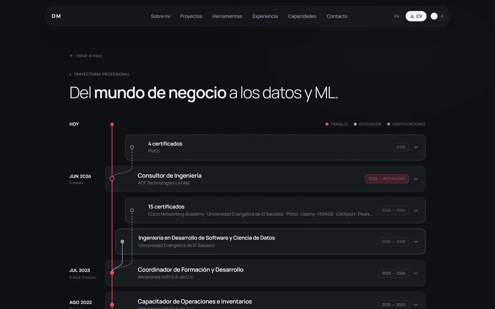
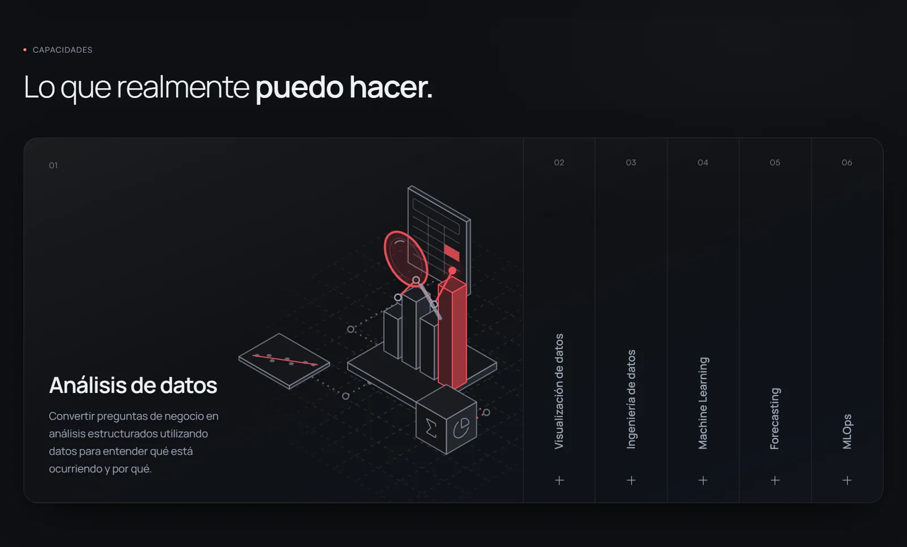
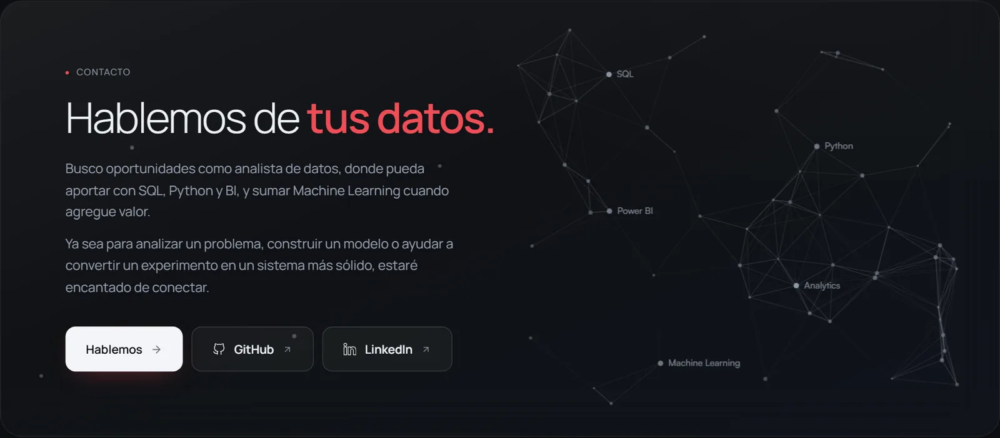
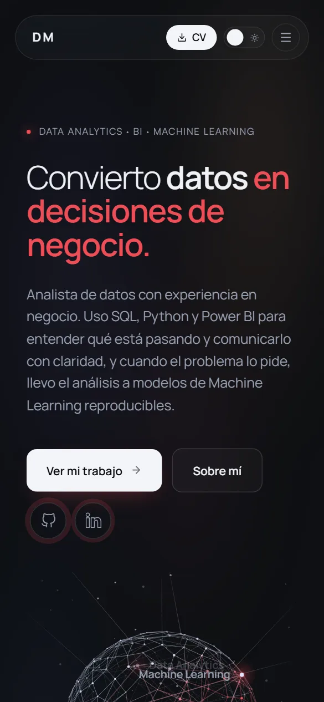

# Dereck Mendez — Portafolio

_Data Analytics · BI · Machine Learning_

[](https://dereckmendez.com)
[](https://github.com/ayorick23/dereckmendez.com/actions/workflows/ci.yml)
[](https://github.com/ayorick23/dereckmendez.com/actions/workflows/deploy.yml)


**[→ dereckmendez.com](https://dereckmendez.com)**



---

## Por qué este portafolio

Soy analista de datos con experiencia en negocio. Mi camino no empezó en un rol de datos: vengo de operaciones de negocio y de analítica de personas/RR. HH., y desde ahí llegué al análisis de datos. Uso SQL, Python y Power BI para entender qué está pasando y comunicarlo con claridad, y cuando el problema lo pide, llevo el análisis a modelos de Machine Learning reproducibles. Machine Learning, MLOps e ingeniería de datos son un diferencial que sumo, no el titular.

Una plantilla genérica o un CV en PDF no podían mostrar ese camino ni la forma en que trabajo. Quería un sitio que:

- Presente **casos de estudio reales y completos**, no solo una lista de herramientas: la pregunta de negocio, el enfoque, las decisiones y el resultado.
- Refleje cómo trabajo: **reproducible, testeado y versionado**, los mismos estándares que aplico a un análisis o a un pipeline, aplicados aquí a un sitio web.
- Hable **inglés y español** de forma nativa, porque mi trabajo ocurre en ambos idiomas.
- Sea algo que **controlo por completo** (el código, el contenido y el despliegue) en vez de un constructor de sitios alquilado.
- Muestre **solo contenido real**: nada de empresas, métricas ni capturas inventadas. Si falta un dato, ese elemento simplemente no aparece ([ADR 0004](docs/decisions/0004-contenido-real-o-nada.md)).

## Recorrido visual

| Modo oscuro (por defecto)                                    | Modo claro                                                   |
| ------------------------------------------------------------ | ------------------------------------------------------------ |
|  |  |

**Proyectos.** Cada caso de estudio tiene una portada animada dibujada por código, relacionada con su tema: salarios nominales contra ajustados por poder adquisitivo, clientes en riesgo de abandono, capas Bronze → Silver → Gold, un odontograma.



**Caso de estudio.** Descripción, tecnologías, métricas reales y secciones narrativas con capturas que se amplían en un visor.



**Experiencia.** En la página de inicio, un diagrama de Gantt con trabajo, educación y certificaciones; en la página completa, una línea de tiempo con ramas que se pliegan desde el nodo de cada puesto.





**Capacidades.** Seis áreas concretas, cada una con su ilustración isométrica.



**Contacto.** Un grafo de nodos estilo Obsidian que reacciona al cursor y conecta con cada botón en su color.



<p align="center">
  
  <br />
  <em>En celular</em>
</p>

## Páginas y secciones

| Página / sección          | Qué muestra                                                                                                                                                                  |
| ------------------------- | ---------------------------------------------------------------------------------------------------------------------------------------------------------------------------- |
| **Inicio · Hero**         | Titular, propuesta en una línea, CTAs y una esfera 3D interactiva con mis áreas de enfoque (arrastrable; cada nodo abre un panel con herramientas y proyectos relacionados). |
| **Inicio · Sobre mí**     | Un adelanto de quién soy, con enlace a la página completa.                                                                                                                   |
| **Inicio · Proyectos**    | Los casos de estudio destacados.                                                                                                                                             |
| **Inicio · Herramientas** | El stack que uso, en una cinta de íconos filtrable por categoría.                                                                                                            |
| **Inicio · Experiencia**  | El diagrama de Gantt de la trayectoria.                                                                                                                                      |
| **Inicio · Capacidades**  | Análisis de datos, visualización, ingeniería de datos, Machine Learning, forecasting y MLOps.                                                                                |
| **Inicio · Contacto**     | Llamado a la acción con email, GitHub y LinkedIn; sin formulario.                                                                                                            |
| **`/about`**              | Historia personal, educación y certificaciones (con sus PDFs).                                                                                                               |
| **`/experience`**         | La trayectoria completa como línea de tiempo con ramas.                                                                                                                      |
| **`/projects`**           | Todos los proyectos, filtrables por disciplina, estado y tecnología.                                                                                                         |
| **`/projects/[slug]`**    | Cada caso de estudio.                                                                                                                                                        |

Todo existe en inglés en `/` y en español en `/es/`, con los mismos componentes; solo cambia el diccionario de textos.

### Proyectos actuales

| Proyecto                                                                                              | Tema                                         | Estado        |
| ----------------------------------------------------------------------------------------------------- | -------------------------------------------- | ------------- |
| [Data & AI Compensation Benchmark](https://dereckmendez.com/projects/data-ai-compensation-benchmark/) | Análisis, estadística aplicada y Power BI    | Publicado     |
| [Telco Churn MLOps](https://dereckmendez.com/projects/telco-churn-mlops/)                             | Machine Learning y MLOps de punta a punta    | Publicado     |
| [E-Commerce Medallion Pipeline](https://dereckmendez.com/projects/ecommerce-medallion-pipeline/)      | Ingeniería de datos (Bronze → Silver → Gold) | En desarrollo |
| [OdontoTrack FOUEES](https://dereckmendez.com/projects/odontotrack-fouees/)                           | Desarrollo de software full-stack            | En desarrollo |

## Stack técnico

|                    |                                                                                                                                                                                                                    |
| ------------------ | ------------------------------------------------------------------------------------------------------------------------------------------------------------------------------------------------------------------ |
| **Framework**      | [Astro](https://astro.build) 7: HTML estático, cero JavaScript de cliente por defecto y transiciones entre páginas con `<ClientRouter />`                                                                          |
| **Lenguaje**       | TypeScript, con schemas estrictos de contenido vía [Zod](https://zod.dev)                                                                                                                                          |
| **Estilos**        | [Tailwind CSS v4](https://tailwindcss.com), con los tokens de diseño y ambos temas en `src/styles/global.css`                                                                                                      |
| **Contenido**      | Content collections de Astro: cada caso de estudio es Markdown tipado en `src/content/projects/{en,es}`                                                                                                            |
| **Interactividad** | TypeScript plano y canvas 2D, sin framework de UI ni librerías 3D ([ADR 0001](docs/decisions/0001-astro-typescript-tailwind-sin-framework-ui.md), [ADR 0007](docs/decisions/0007-canvas-2d-propio-sin-threejs.md)) |
| **Íconos**         | [astro-icon](https://github.com/natemoo-re/astro-icon) con un set local de SVGs monocromos que siguen el tema (`src/assets/icons/`)                                                                                |
| **Fuentes**        | Manrope (títulos y texto) vía [Fontsource](https://fontsource.org) y Satoshi (etiquetas) vía [Fontshare](https://www.fontshare.com)                                                                                |
| **SEO / redes**    | `@astrojs/sitemap` y portadas `og:image` propias, generadas con `@napi-rs/canvas` a partir de las mismas portadas animadas                                                                                         |
| **Calidad**        | ESLint, Prettier, Vitest, Playwright con axe (WCAG 2.1 AA), Lighthouse CI y verificador de enlaces                                                                                                                 |
| **Hosting / CI**   | GitHub Pages con dominio propio (`dereckmendez.com`, DNS en Cloudflare), build y deploy con GitHub Actions                                                                                                         |

## Decisiones de diseño

El sitio debe sentirse **construido a mano, no armado con una plantilla**: oscuro por defecto, un acento carmesí contenido, mucho espacio y cada animación con un propósito.

- **Oscuro por defecto, claro como alternativa real.** Ambos temas están definidos por completo sobre los mismos tokens (`data-theme` en `<html>`); el claro no es un añadido de último momento.
- **La esfera del hero** muestra que mis áreas de trabajo están conectadas, no son cajas separadas en un CV. Es 3D proyectado a mano en canvas 2D y sus nodos son botones reales, accesibles con teclado.
- **Portadas dibujadas por código** en lugar de imágenes de stock, una por proyecto y relacionadas con su tema. Las mismas funciones de dibujo, congeladas en un cuadro, generan la portada para redes sociales ([ADR 0006](docs/decisions/0006-portadas-dibujadas-por-codigo.md)).
- **El grafo de contacto** reemplazó a una nebulosa WebGL que se veía distinta en cada computadora: el canvas 2D se ve igual en todas y pesa mucho menos.
- **Rendimiento en celular cuidado:** las animaciones se pausan fuera de pantalla y respetan `prefers-reduced-motion`, y el grafo de contacto baja a 30 fps en pantallas chicas.

## Funcionalidades notables

**Selector de idioma (EN ⇄ ES).** El botón salta a la página equivalente en el otro idioma (`/es/projects/telco-churn-mlops` → `/projects/telco-churn-mlops`), no al inicio. La elección se guarda _antes_ de navegar, así que una visita posterior a `/` respeta el último idioma elegido.

**Tema oscuro ⇄ claro.** Se guarda la preferencia y se vuelve a aplicar después de cada cambio de página, para que nunca destelle el tema equivocado durante la navegación.

**Todo el texto en diccionarios tipados.** Ningún componente tiene texto escrito a mano: todo vive en `src/content/i18n/{en,es}.ts` con una forma compartida, y un test falla si un texto existe en un idioma y no en el otro.

**Contenido validado.** Cada caso de estudio se valida contra un schema en ambos idiomas: un campo roto o faltante hace fallar el build en vez de publicar una página vacía.

**Portadas para redes sociales.** Cada página tiene su propia `og:image`: una tarjeta general y una por caso de estudio, con su categoría, título, métricas reales y su portada animada. Se generan con `npm run generate:og` y se versionan en `public/og/`.

**Página 404 bilingüe.** GitHub Pages sirve un único `404.html`; la página elige el idioma según la ruta o la preferencia guardada.

## Calidad y CI

Cada Pull Request pasa por el job **Check, audit & build** (`.github/workflows/ci.yml`), y `main` está protegida: nada entra sin pasarlo.

| Revisión                  | Herramienta                                                                               |
| ------------------------- | ----------------------------------------------------------------------------------------- |
| Tipos                     | `astro check`                                                                             |
| Lint y formato            | ESLint y Prettier                                                                         |
| Seguridad de dependencias | `npm audit` con excepciones documentadas y con fecha de revisión (`audit-allowlist.json`) |
| Unitarios y contenido     | Vitest: helpers, paridad de idiomas, integridad de datos y estructura de los proyectos    |
| Extremo a extremo         | Playwright en escritorio y celular: carga de páginas, idioma, tema, menú y 404            |
| Accesibilidad             | axe (WCAG 2.1 AA) en todas las páginas, en ambos temas                                    |
| Rendimiento y SEO         | Lighthouse CI                                                                             |
| Enlaces                   | Internos y anclas en cada PR; externos una vez por semana (`links-external.yml`)          |

Dependabot propone actualizaciones (dependencias de npm cada semana, GitHub Actions cada mes), y el deploy (`deploy.yml`) publica en GitHub Pages en cada push a `main`.

## Cómo correrlo

Requiere Node 22.12 o superior.

```bash
npm install            # dependencias
npm run dev            # servidor local en localhost:4321
npm run build          # build de producción a ./dist/
npm run preview        # previsualizar el build
npm test               # Vitest (unitarios y contenido)
npm run test:e2e       # Playwright contra el build (correr `npm run build` antes)
npm run verify         # todo: tipos, lint, formato, Vitest, build, enlaces y Playwright
npm run generate:og    # regenerar las portadas de public/og/
```

> **Nota:** `astro-icon` lee `src/assets/icons/` una sola vez, al arrancar el servidor. Si agregas o editas un ícono con el servidor corriendo, reinícialo (`npx astro dev stop` y luego `npm run dev`); refrescar el navegador no alcanza.

## Estructura del proyecto

```plaintext
dereckmendez.com/
├── .claude/                     # Contexto, reglas y procedimientos para desarrollar con Claude Code
├── .github/workflows/           # ci.yml, deploy.yml, links-external.yml
├── docs/
│   ├── decisions/               # Decisiones de arquitectura y diseño (ADRs)
│   ├── roadmap.md               # Qué falta
│   └── screenshots/             # Capturas de este README
├── public/
│   ├── certificates/            # PDFs de los certificados
│   ├── cv/                      # CVs descargables por idioma
│   ├── og/                      # Portadas para redes sociales (generadas)
│   └── projects/                # Imágenes reales de cada caso de estudio
├── scripts/                     # Portadas og, filtro de audit, verificador de enlaces, render de certificados
├── src/
│   ├── assets/                  # Íconos SVG locales, fotos y miniaturas de certificados
│   ├── components/
│   │   └── views/               # El contenido de cada página (Home, About, Experience, Projects)
│   ├── content/
│   │   ├── i18n/                # Todo el texto de la interfaz (en.ts, es.ts, types.ts)
│   │   └── projects/{en,es}/    # Casos de estudio en Markdown, mismos slugs en ambos idiomas
│   ├── data/                    # Datos sin idioma: nav, redes, herramientas, certificados, educación…
│   ├── layouts/                 # BaseLayout (meta, tema, idioma) y ProjectLayout
│   ├── lib/                     # Helpers puros con tests (fechas, idiomas, experiencia, portadas…)
│   ├── pages/                   # Wrappers delgados por ruta; es/ replica las rutas en español
│   ├── scripts/                 # TypeScript plano de la interactividad (esfera, portadas, grafo…)
│   └── styles/global.css        # Tokens de diseño y ambos temas
├── tests/
│   ├── unit/  content/          # Vitest
│   └── e2e/                     # Playwright + axe
├── astro.config.mjs
└── lighthouserc.json
```

Las decisiones importantes, con su contexto y alternativas, están en [`docs/decisions/`](docs/decisions/), y lo pendiente en [`docs/roadmap.md`](docs/roadmap.md).

## Licencia

[MIT](./LICENSE): el código y la estructura del sitio son libres de reutilizar, con atribución. Esto **no** incluye mi contenido personal (CV, textos de los casos de estudio, fotos, certificados ni descripciones de proyectos), que sigue siendo mío.
